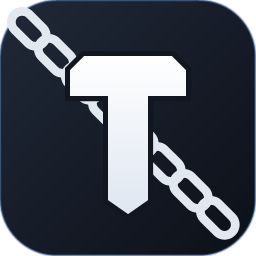

# T约束 · dsh-tlock

> 给每一轮生成装上「刹车」：**token 到量就断、时间到点就断**，断下来的内容自动收进桌面归档。



---

## 上架字段速填（复制粘贴用）

| 字段 | 值 |
| --- | --- |
| 显示名 | `T约束` |
| 包名 | `dsh-tlock` |
| 分类 | 工具集成（tools） |
| 标签 | `anti-addiction` `cost-control` `quota` `cordis-plugin` `限流` `token预算` |
| 语言 | JavaScript（ESM，无构建步骤） |
| 许可 | MIT |
| 仓库 | `https://github.com/<你的用户名>/dsh-tlock` |
| 安装 | `dsh plugin --profile desktop add github:<你的用户名>/dsh-tlock#v0.2.1` |

**一句话简介（中文，≤120 字）**

> DeepSeek Harness 插件：T约束 —— 每轮生成的 token / 时间双闸，到量即断、超时即断，断下的内容自动归档到桌面（简洁描述 / AI联动分析两种视角），支持 DSH 内悬浮球面板与桌面控制台。

**One-liner (EN, ≤200 chars)**

> T-Lock for DeepSeek Harness: a per-turn token **and** time budget that hard-stops generation at the limit, then archives what was produced to your Desktop (human-readable brief or AI-ready analysis). Floating panel inside DSH + optional desktop console.

**English short description (for the EN listing page)**

> A per-turn brake for your agent. Set a token cap (5K–1M) and a time cap (1–120 min); T-Lock stops generation the moment either is hit, asks you at 80% / 90%, and writes the finished text — plus a compressed reasoning trace and touched-file list — to `Desktop\DSH限定生成内容\`. Two archive flavours: a one-screen **brief** for humans, and an **AI analysis** file you can paste into any model. Ships a draggable floating ball inside DSH (not on your desktop) and an optional tray console that shares the same settings file. No network calls, no dependencies, MIT.

**正文**：用本文件下面从「为什么要它」开始的部分即可（GitHub 仓库的 README 直接放它）。

---

## 为什么要它

问一个简单问题，AI 回了两万字；想让它「写个草稿」，结果它顺手重构了整个项目——**你没法在开跑之前说清楚"到这儿就停"**。

T约束 就是那道闸：

- **按 token 限**：一轮最多写多少（5 千 ~ 100 万），到量硬断；
- **按时间限**：一轮最多跑多久（1 分钟 ~ 2 小时），到点硬断；
- **断了不丢**：已经生成的内容自动归档到桌面，还能一键「继续生成」接着写。

---

## 核心能力

### 1. 双闸·到量即断

| 闸 | 量程 | 精度 |
| --- | --- | --- |
| Token | 5 千 ~ 100 万 / 轮 | 实时估算 + 尝试结束时精确校准 |
| 时间 | 1 分钟 ~ 2 小时 / 轮 | 从你按下发送开始计（含工具调用耗时） |

到 80% / 90% 会先问一句「还接着生成吗」，你点「到此为止」立刻断、点「继续」就不打扰你。

### 2. 滑条·一眼看清

两条**黑色滑条**，6 个整点把量程均分成 5 段，刻度正好落在 1/5、2/5、3/5、4/5 上，**拖到刻度附近自动吸附**；不想要整点就点「手动输入」填任意值。

- token 整点：5 千 / 5 万 / 20 万 / 40 万 / 70 万 / 100 万
- 时间整点：1 / 10 / 30 分钟 · 1 / 1.5 / 2 小时

**用量进度条是绿色的**，一眼看出这轮吃掉多少。

### 3. 归档·两种视角

断了之后自动在桌面建文件夹：`桌面\DSH限定生成内容\{token限定版|时间限定版|手动结束}\时间_会话名\`

| 模式 | 产出 | 适合 |
| --- | --- | --- |
| **简洁描述** | `生成说明.md`：这轮在说什么、内容骨架、动过哪些文件、几段代码、正文 | 人看，扫一眼就知道写了什么 |
| **归档完全记录**（推荐） | `完整记录.md` + `完整记录.json`：完整思考过程、全部工具参数与返回、正文原文 | 想一字不落地回看/喂模型，选这个 |
| **两个都要** | 上面两份 + `meta.json` | 既要存档又要喂模型 |

不想要归档？点「解除归档」，到量照样断，只是不写文件。

### 4. DSH 里的黑色悬浮球

右下角一颗 46px 的黑色方块（**只存在于 DSH 页面里**，不在桌面），图案就是 T约束 的斜链锁 T。点开是面板，可拖动、位置会记住；硬断时变成橙框提醒你「有一轮等你决定」。

面板三个页签：

- **约束模式** —— 滑条、归档模式、本轮进度、继续/结束
- **查看历史归档记录** —— 面板里直接读归档内容、重命名、在文件夹中显示
- **查看历史归档记录** —— 每一次断档的清单，点开直接定位文件夹
- **设置** —— 插件开关、悬浮球开关、开机自启、页面大小、语言（中文 / English）、打开归档目录

### 5. 输入前先问一句

约束关着的时候，你按下发送会先被拦一下：

> 要不要开约束？

点「确认约束」→ 开启并弹出面板；不想开 → **再按一次 Enter 直接发送**。再也不会"忘了开闸就让它狂写"。

### 6. 桌面控制台（可选）

`TLock.exe` 常驻托盘，不打开 DSH 也能拉滑条、切归档模式、进归档目录；默认开机自启，可在设置里关掉。

它和 DSH 里的面板**共用同一份设置文件**，两边改都一样。

---

## 快速上手

```bash
# 安装（发布后）
dsh plugin --profile desktop add dsh-tlock

# 本地开发安装
dsh plugin --profile desktop add file:C:/path/to/dsh-tlock
```

1. 重启 DSH（或刷新页面）→ 右下角出现黑色方块；
2. 点开 → 拉滑条设定本轮上限 → 关掉面板；
3. 正常提问。到量会自动硬断 + 归档 + 问你是否继续。

---

## 归档长这样

```
桌面\DSH限定生成内容\token限定版\20261107-214503_重构登录模块\
├── 生成说明.md      # 人看的
├── 完整记录.md      # 一字不落（推荐）
├── 完整记录.json    # 同上，程序读取用
└── meta.json        # 机器读的（用量、耗时、模型、限制）
```

`生成说明.md` 节选：

```markdown
（未命名会话） · token限定版
======================================

2026-11-07 21:45　用时 43 秒　用量 3643 / 9.86 万 token

这一轮在说什么
--------------------------------------
重构了登录模块的三个文件，把 session 校验抽成中间件……

动过的东西
--------------------------------------
· src/auth.js（3 次）
· src/middleware/session.js（2 次）
```

---

## 设置项

| 键 | 默认 | 说明 |
| --- | --- | --- |
| `enabled` | `true` | 插件总开关 |
| `tokenLimit` | `20000` | 每轮 token 上限（5000 ~ 1000000） |
| `timeLimitSec` | `300` | 每轮时间上限（60 ~ 7200 秒） |
| `archiveEnabled` | `true` | 是否归档 |
| `archiveMode` | `brief` | `brief` / `full` / `both`（旧值 `ai` 自动升级为 `full`） |
| `warnPct` | `[0.8, 0.9]` | 预警阈值 |
| `ball` | `true` | DSH 内悬浮球 |
| `autoStart` | `true` | 桌面控制台开机自启 |
| `panelSize` | `m` | 面板尺寸 `s` / `m` / `l` |
| `lang` | `zh` | `zh` / `en` |

设置存在 `%USERPROFILE%\.dsh\storages\dsh-tlock\settings.json`，改完 ≤500ms 生效，不用重启。

---

## 隐私与安全

- **纯本地**：不联网、不上报、不读你的对话正文去别处；插件代码只依赖 `node:fs` / `node:os` / `node:path` / `node:child_process`。
- **只做三件事**：读会话事件算用量、调 `agent.cancel()` 断生成、把归档写进桌面。
- **不做的事**：不改你的提示词、不动模型输出、不拦截除「发送前询问」以外的任何输入。
- 所有数据：`settings.json` / `status.json` / `commands.json` / `history.json` 都在上面那个目录里，删掉即清空。

---

## 已知边界（先说清楚）

1. **token 是"准实时"**：宿主只在一次尝试结束时回报精确 usage，流式过程中用字符数估算。因此实际值可能**略超上限一点点**（一次尝试的量级），断点之后不会继续涨。
2. **时间闸包含工具调用**：你按下发送就开始计时，跑代码、查文件的时间都算——所以长任务常常是"时间先到"。
3. **只管当前会话的这一轮**：子代理、后台任务不并入父轮计数；对它们单独发消息才会开新一轮。
4. **硬断在安全点生效**：正在执行的工具调用不会被强行截断，会在下一个可中断点停下。

---

## 常见问题

**Q：设了 20 万，是不是必须生成 20 万？**
不是。上限不是配额，写得短就早停；额度按轮重置，下一轮重新算。

**Q：断了之后内容会丢吗？**
不会。断的那一刻先写一份快照，中断消息回来后再用精确数据覆盖同一份，正文和思考都在。

**Q：和 dsh-ration 冲突吗？**
不冲突。两者独立计量；你要更严格就同时开，T约束 的闸会先触发。

**Q：能只算正文、不算思考吗？**
V1 没做这个口径——按宿主回报的 `outputTokens` 统一计。需要的话可以加。

---

## 更新日志

- **0.2.1** — 英文界面完整化（K/M 单位、所有提示中英双语）、滑条 + 吸附、三种归档模式、历史记录页、DSH 悬浮球、输入前拦截、设置页、斜链锁 T 图标、开场动效（已按反馈移除）、桌面控制台重做
- **0.1.0** — 双闸核心、桌面归档、悬浮提示

---

## 元信息

- 包名：`dsh-tlock`　显示名：**T约束**　版本：`0.3.0`
- 形态：DSH 插件（宿主 + Web 客户端）+ Windows 桌面控制台
- 许可：MIT　运行环境：DSH ≥ 0.2.1，Node ≥ 22
- 依赖：无（不引入任何三方运行时依赖）

---

## 发布前检查清单

- [ ] `package.json` 补 `repository` / `author` / `homepage`（市场页会从这些字段推作者与仓库）
- [ ] `lib/client.js` 是**预构建**产物，直接提交进仓库（市场安装不需要构建链）
- [ ] `files` 已包含 `lib`、`cordis.patch.yml`、`README.md` ✓
- [ ] 仓库里放 `app/icon-preview.png`（256×256）当市场页封面
- [ ] 打 tag：`git tag v0.2.1 && git push --tags`
- [ ] 按 tag 装一遍验证：`dsh plugin --profile web add https://codeload.github.com/<owner>/dsh-tlock/tar.gz/v0.3.0`
      （用 tarball 而不是 `github:` —— pnpm ≥ 10 会因 prepare 脚本拦下 git 依赖）
- [ ] 不需要 `allowBuilds` 授权：包内没有 build 脚本
- [ ] 装完确认 DSH 右下角出现悬浮球、`/dsh-tlock/health` 返回 `{"ok":true,"version":"0.2.1"}`
- [ ] 桌面控制台单独分发（`TLock.exe`），市场页注明「Windows 可选组件」

